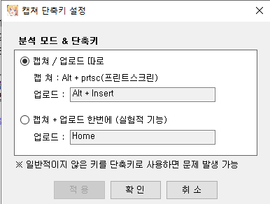

# vArchiveHelper 사용 매뉴얼

DJMAX RESPECT V에서 **「전체 화면 최적화 사용 중지」를 켠 채** 결과 화면을 v-archive에 올리는 프로그램입니다.

그 옵션은 프레임에 도움이 된다고 알려져 있지만, 켜 두면 v-archive가 화면을 제대로 읽지 못하는 경우가 있습니다. 보더리스로 바꾸지 않아도 되게, 이 프로그램이 모니터를 직접 캡처해서 클립보드에 넣고 v-archive 인식을 호출합니다.

```
결과 화면
  → 헬퍼 단축키
  → 선택한 모니터 전체 캡처 (DXGI)
  → 지정한 해상도로 맞춤
  → 클립보드
  → v-archive에 Alt+Insert
```

필요한 것: [v-archive](https://github.com/kokonohanahata/v-archive), Windows 10/11, .NET Framework 4.7.2.
문의는 [GitHub 이슈](https://github.com/jinthek123/vArchiveHelper/issues)에 남겨 주세요.

---

## 1. 누구를 위한 프로그램인가

DJMAX RESPECT V를 전체 화면으로 플레이하면서, 호환성 탭의 **「전체 화면 최적화 사용 중지」를 켜 둔 사람**을 위한 프로그램입니다.

그 체크를 끄거나 창 모드로 바꾸면 v-archive만으로도 올라가는 경우가 많습니다. 이 헬퍼는 그 옵션을 **끄지 않고** 올리고 싶을 때 씁니다.

게임 실행 파일 `DJMAX RESPECT V.exe` → 속성 → 호환성에서 해당 체크는 그대로 둡니다. DXGI 캡처가 실패해도 이 체크를 해제하지 마세요. 실패 원인은 아래 [8. 자주 막히는 곳](#8-자주-막히는-곳)에 있습니다.

---

## 2. 설치

1. Releases의 `vArchiveHelper.zip` 압축을 풉니다.
2. `vArchiveHelper.exe`와 같은 폴더의 dll을 같이 둡니다. exe만 다른 곳으로 옮기면 실행되지 않습니다.
3. exe를 실행합니다. 처음이면 v-archive 경로를 묻습니다. `v-archive.exe`를 지정하고 저장합니다.

이미 실행 중이면 두 번째 창은 뜨지 않습니다. 작업 표시줄이나 트레이를 확인하세요.

---

## 3. v-archive 단축키

헬퍼를 쓰기 전에, v-archive의 **캡처 단축키 설정**을 아래 그림과 같게 맞춥니다. 여기가 어긋나면 캡처는 성공해도 곡 인식으로 이어지지 않습니다.



| 항목 | 값 |
| --- | --- |
| 분석 모드 | **캡처 / 업로드 따로** |
| 캡처 | `Alt + PrtSc` (프린트스크린) |
| 업로드 | `Alt + Insert` |

**업로드 키는 `Alt + Insert` 그대로 둡니다.** 헬퍼가 클립보드에 이미지를 넣은 뒤 이 조합을 직접 보냅니다. v-archive에서 업로드 키를 바꾸면 헬퍼는 따라가지 않습니다.

「캡처 + 업로드 한번에」는 사용하지 않습니다.

헬퍼 창의 캡처 단축키와 v-archive의 업로드 키는 서로 다른 키입니다. 헬퍼 기본 키는 `Insert`이고, v-archive 업로드는 `Alt+Insert`입니다.

---

## 4. 헬퍼 설정

창 맨 아래 **적용 및 저장**을 눌러야 모니터, 경로, 해상도, DXGI 옵션이 반영됩니다. 단축키만은 **단축키 지정**에서 키를 누르는 즉시 저장됩니다.

### 전체화면 캡처

세 항목 모두 켜 두는 구성을 권장합니다.

| 옵션 | 의미 |
| --- | --- |
| DXGI 캡처 (권장) | 모니터 전체를 Desktop Duplication으로 읽습니다. 전체 화면 최적화를 끈 상태에서도 현재 화면을 가져오기 위한 경로입니다. |
| DXGI 필수 — 실패 시 중단 | DXGI가 실패하면 다른 방식으로 넘기지 않고 멈춥니다. 실패를 상태 줄에서 바로 볼 수 있습니다. |
| 물리 픽셀 | Windows 배율(125%, 150% 등)과 관계없이 모니터의 실제 해상도로 읽습니다. 2560×1440 패널을 125%로 쓰면 논리 크기는 2048×1152인데, 이 옵션을 켜면 2560×1440으로 맞춥니다. |

저장 후 캡처가 성공하면 상태 줄에 `[DXGI]`가 보여야 합니다.

### 캡처 대상

**결과 화면이 나오는 모니터**를 고릅니다. v-archive 창이 떠 있는 모니터와 다를 수 있습니다.

목록은 `모니터 2 — 1920×1080 (Index 2)`처럼 표시됩니다. 번호는 1부터입니다.

### v-archive

**exe 경로**에 `v-archive.exe`를 지정합니다. **찾기**로 골라도 됩니다. 경로가 없으면 캡처 뒤 인식이 실행되지 않습니다. 캡처 시 v-archive가 꺼져 있으면 이 경로로 실행한 뒤 인식을 보냅니다.

### v-archive 출력 (가로×세로)

캡처한 그림을 v-archive에 넘기기 전에 이 크기로 맞춥니다. **결과 화면의 실제 해상도**와 같게 둡니다.

프리셋: FHD 1920×1080, QHD 2560×1440, UHD 3840×2160, FHD 16:10 1920×1200, QHD 16:10 2560×1600.

**선택 모니터 해상도**는 위에서 고른 모니터의 실제 픽셀을 가로·세로에 넣습니다. 배율을 쓰는 패널이면 물리 픽셀이 켜져 있을 때의 크기입니다.

1080p 모니터를 고르고 출력만 QHD로 두면 그림을 키워서 넘깁니다. 인식이 흔들리면 출력 크기를 그 모니터와 같게 맞추세요.

### 캡처 단축키

1. **단축키 지정**을 누릅니다.
2. 결과 화면에서 누를 키를 입력합니다. `Ctrl+Shift+F12`처럼 조합도 됩니다.
3. 상태 줄에 `단축키 저장됨`이 나오면 등록된 것입니다.
4. 입력 중에 **Esc**를 누르면 취소됩니다.

`Ctrl`, `Alt`, `Shift`만으로는 등록되지 않습니다. Windows 키도 사용할 수 없습니다. 다른 프로그램이 이미 그 조합을 쓰고 있으면 등록에 실패합니다. 그때는 조합을 바꿉니다.

키를 바꾸기 전에 동작을 보고 싶으면 **캡처 동작 실행**을 누릅니다. 단축키와 같은 캡처를 한 번 수행합니다.

### 실행, 표시

**트레이에서 실행**은 기본으로 꺼져 있습니다. 끄면 창을 닫을 때 프로그램이 종료됩니다.

켜고 저장한 뒤 창을 닫으면 트레이로 숨습니다. 단축키는 계속 동작합니다. 끝낼 때는 트레이 아이콘 메뉴의 **종료**를 누릅니다. 창의 닫기 버튼은 종료가 아닙니다.

테마는 라이트와 다크가 있습니다. 캡처에는 영향이 없습니다.

---

## 5. 플레이 중 올리는 순서

1. v-archive 단축키가 [3장 그림](#3-v-archive-단축키)과 같은지 확인합니다.
2. 헬퍼에서 모니터, 해상도, DXGI 세 옵션, exe 경로를 맞추고 **적용 및 저장**을 누릅니다.
3. 곡이 끝난 결과 화면에서 **헬퍼 단축키**를 누릅니다. 기본은 `Insert`입니다.
4. 헬퍼 상태 줄을 확인합니다.

성공하면 이런 형태입니다.

```
완료 — 2560×1440, [DXGI], Index 1 · 클립보드→인식
```

숫자는 출력 해상도이고, Index는 캡처한 모니터 번호입니다. `[DXGI]`가 있어야 합니다.

한 번 더 올릴 때도 같은 키입니다. v-archive의 `Alt+PrtSc`를 따로 누를 필요는 없습니다.

---

## 6. 창을 닫으면

| 트레이에서 실행 | 창을 닫으면 | 완전히 끝내려면 |
| --- | --- | --- |
| 꺼짐 (기본) | 프로그램 종료 | 창을 닫으면 됩니다 |
| 켜짐 | 트레이로 숨김. 단축키 유지 | 트레이 메뉴 **종료** |

숨긴 뒤에는 트레이 아이콘으로 창을 다시 엽니다. 실행 파일이 이미 떠 있는데 또 실행하면, 새 창 대신 기존 인스턴스를 확인하라는 안내가 나옵니다.

---

## 7. 상태 줄

창 위쪽 `현재:` 한 줄이 마지막 캡처 결과입니다.

| 표시 | 의미 |
| --- | --- |
| `완료 — … [DXGI] … 클립보드→인식` | 캡처 후 v-archive 인식 키까지 보냈습니다. |
| `캡처하는 중입니다.` | 진행 중입니다. 연타하지 않아도 됩니다. |
| `DXGI 캡처 실패: DXGI FATAL: …` | DXGI가 화면을 열지 못했습니다. 아래 8장을 보세요. |
| `단축키(…)를 등록하지 못했습니다` | 그 키를 다른 프로그램이 쓰고 있습니다. |

DXGI가 실패한 채로는 그림을 넘기지 않습니다. **DXGI 필수**가 켜져 있으면, 실패한 화면을 그대로 인식에 넣지 않고 멈춥니다.

---

## 8. 자주 막히는 곳

### 전체 화면에서 같은 곡만 반복될 때

「전체 화면 최적화 사용 중지」를 켠 독점 전체 화면은, 일반 캡처가 이전 프레임이나 빈 화면을 돌려주는 경우가 있습니다. v-archive는 그 그림을 새 결과로 읽어 같은 곡을 다시 올립니다.

헬퍼는 이 경로를 쓰지 않게 DXGI로 현재 모니터를 읽습니다. 상태 줄이 `[DXGI]`인 완료인지 먼저 확인하세요. DXGI 없이 넘어간 캡처는 같은 증상이 다시 날 수 있어서, **DXGI 필수 — 실패 시 중단**을 켜 둡니다.

### DXGI 캡처 실패

상태 줄의 `DXGI FATAL`은 캡처 수단이 화면을 열지 못했다는 뜻입니다. 게임 호환성 체크를 풀기 전에 아래를 순서대로 봅니다.

1. **DXGI 캡처**, **DXGI 필수**, **물리 픽셀**이 켜져 있는지 확인하고 저장합니다.
2. 콤보의 모니터가 **결과 화면이 나온 모니터**인지 확인합니다. v-archive 창이 있는 쪽이 아닐 수 있습니다. 바꾼 뒤에는 적용 및 저장을 누릅니다.
3. 출력 해상도를 그 모니터와 맞춥니다. **선택 모니터 해상도**를 누른 뒤 저장하면 됩니다.
4. v-archive 단축키가 [3장 그림](#3-v-archive-단축키)과 같은지 확인합니다. 이 그림과 DXGI 실패는 별개입니다. 그림이 맞아도 DXGI 단계에서 멈출 수 있습니다.

로그 파일은 `%TEMP%\vArchiveHelper-dxgi.log` 입니다. 같은 시각의 `STAGE=` 한 줄이 어디서 거절됐는지 보여 줍니다.

그래픽 카드가 두 개인 PC에서 `DuplicateOutput` 과 `매개 변수가 틀립니다` (`0x80070057`)가 같이 나오면, 고른 모니터와 헬퍼가 쓰는 GPU가 다른 경우입니다. 노트북의 내장 그래픽(AMD, Intel)과 NVIDIA가 모니터를 나눠 가지는 구성에서 자주 납니다.

그때 선택할 수 있는 방법은 두 가지입니다.

- 결과 화면을, 캡처가 되는 쪽 모니터로 옮기고 헬퍼 모니터도 그쪽으로 저장합니다.
- Windows **설정 → 시스템 → 디스플레이 → 그래픽 설정**에서 `vArchiveHelper.exe`를 추가하고, 그 모니터가 붙은 GPU와 같은 쪽(고성능 또는 절전)으로 지정합니다. 저장한 뒤 헬퍼를 트레이의 **종료**까지 완전히 끄고 다시 실행합니다. 한쪽 모니터만 맞추면 반대쪽 모니터 캡처는 같은 오류가 날 수 있습니다.

### 인식이 안 될 때

캡처 완료 문구는 나왔는데 v-archive가 반응하지 않으면, 화면이 아니라 단축키 쪽을 봅니다.

- v-archive 분석 모드가 **캡처 / 업로드 따로** 인지
- 업로드가 **`Alt+Insert`** 인지
- 헬퍼 단축키를 `Alt+Insert`로 지정하지 않았는지 (업로드 키와 겹칩니다)
- exe 경로의 `v-archive.exe`가 실제로 그 클라이언트인지

### 단축키를 눌러도 조용할 때

상태 줄에 등록 실패가 남아 있으면 그 조합은 쓰이지 않습니다. 다른 키로 저장하세요. 창을 닫아 프로그램이 종료된 것은 아닌지 확인합니다. 트레이 실행을 켜 두었다면 트레이에 아이콘이 있어야 합니다.

---

## 9. 기본값

처음 실행과 `appsettings.example.json` 기준입니다.

| 항목 | 기본 |
| --- | --- |
| DXGI 캡처 | 켜짐 |
| DXGI 필수 | 켜짐 |
| 물리 픽셀 | 켜짐 |
| 캡처 단축키 | `Insert` |
| 트레이에서 실행 | 꺼짐 |
| 테마 | 라이트 |
| v-archive에 보내는 인식 키 | `Alt+Insert` (고정) |
